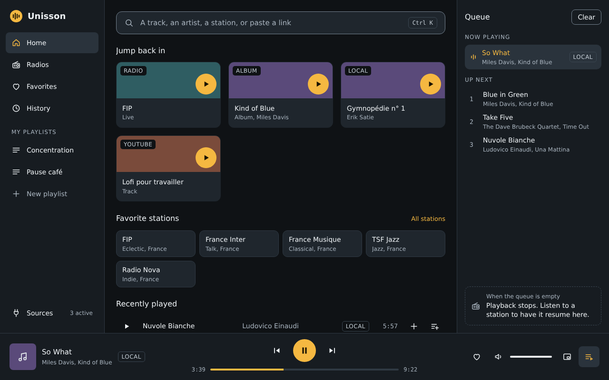
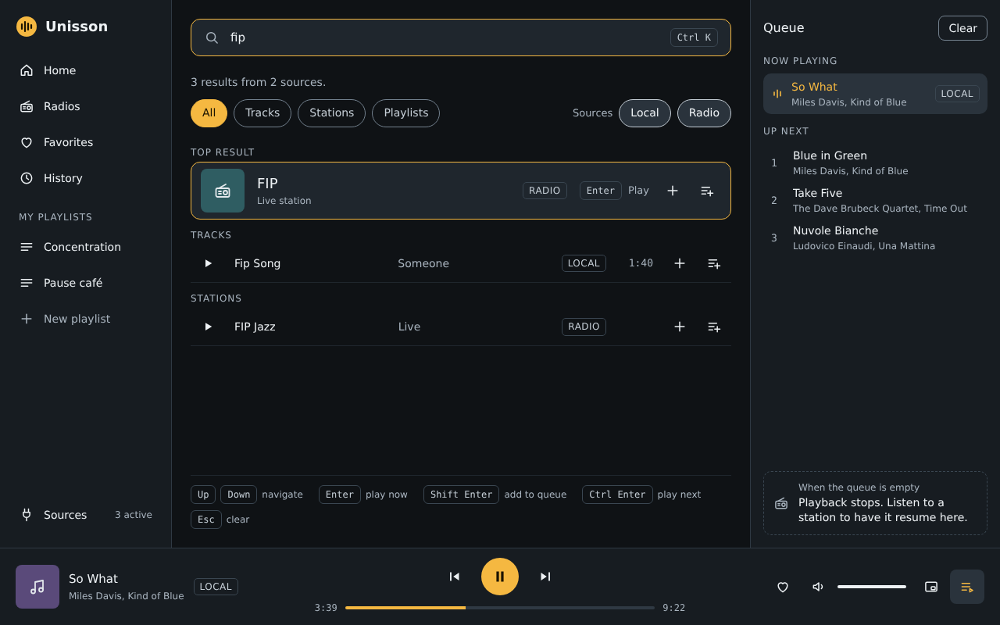
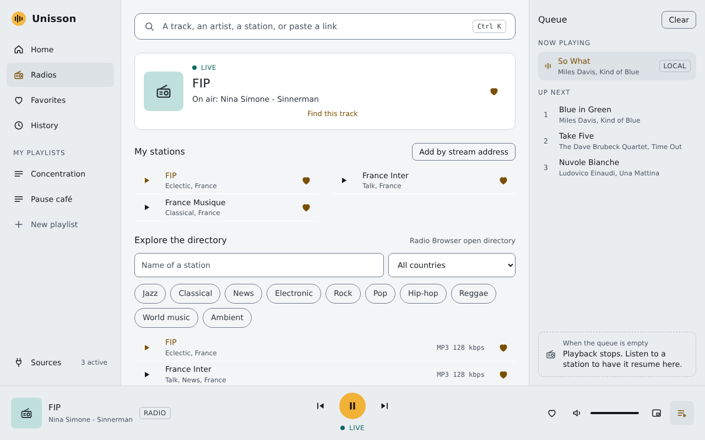
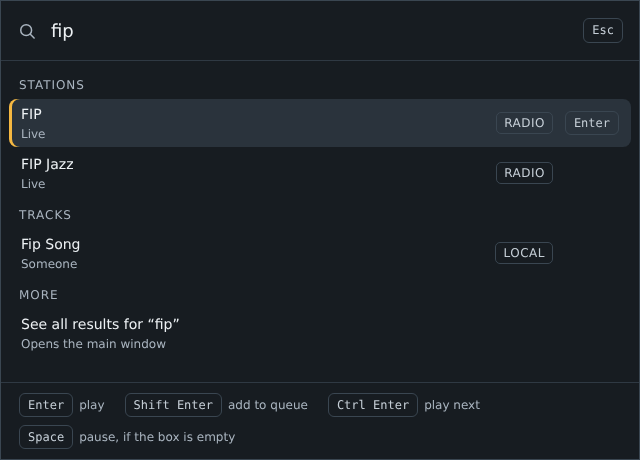
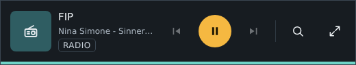

<div align="center">


# Unisson

**One search box and one play queue for internet radio, local files and YouTube.**

A desktop audio player for Linux, written in Rust.

[](https://github.com/geekabel/Unisson/actions/workflows/ci.yml)
[](https://github.com/geekabel/Unisson/releases)
[](#license)

[Install](#install) · [User guide](docs/guide.md) · [Guide en français](docs/guide.fr.md) · [Build from source](#build-from-source) · [Contributing](CONTRIBUTING.md)



</div>

## Why Unisson

Music is scattered: a few radio stations in a browser tab, albums in a folder,
a mix on YouTube. Unisson puts them behind one search field and plays them in
one queue, without an account and without leaving the keyboard.

## Features

- **Four sources, one search.** Type a few letters: local files, radio
  stations, Spotify and YouTube answer in the same list. Paste a stream
  address, a YouTube or Spotify link, or the path of a file to play it
  directly.
- **Internet radio.** Browse the free [Radio Browser](https://www.radio-browser.info)
  directory by name, genre and country. Keep your stations, see the title on
  air, and let Unisson reconnect when the network drops.
- **Local library.** Your music folder is scanned and watched: a file you
  copy there appears a few seconds later. Search ignores case and accents.
- **One queue.** Play now, play next or add to the queue, from any source.
  When the queue runs out, your last station can take over.
- **Favorites, history and playlists**, kept in a local database.
- **Part of the desktop.** Media keys and the GNOME media controls (MPRIS), a
  tray icon that keeps the music going when the window is closed, a
  mini-player, notifications, and a quick launcher that opens over your work.
- **Keyboard first.** Every control is reachable with Tab, with shortcuts for
  the transport, the volume and the screens.
- **Yours to read.** Dark and light themes checked against WCAG 2.1 AA
  contrast, a display you can enlarge, and an interface in English and French.
- **Private by design.** No account, no telemetry, no update check. See
  [Privacy](#privacy).

<table>
  <tr>
    <td width="50%"></td>
    <td width="50%"></td>
  </tr>
  <tr>
    <td align="center"><em>One search, every source</em></td>
    <td align="center"><em>Stations and the directory, light theme</em></td>
  </tr>
  <tr>
    <td></td>
    <td></td>
  </tr>
  <tr>
    <td align="center"><em>The quick launcher: a shortcut, a few letters, Enter</em></td>
    <td align="center"><em>The mini-player</em></td>
  </tr>
</table>

## Install

Installers are on the [releases page](https://github.com/geekabel/Unisson/releases).
Each release lists the SHA-256 sum of its files in `SHA256SUMS`.

### Ubuntu and Debian

Unisson targets Ubuntu 22.04 and newer, with GNOME. Download the `.deb` file,
then:

```sh
sudo apt install ./Unisson_0.1.0_amd64.deb
```

`apt` installs the GStreamer plugins and the other libraries with it. Unisson
then appears in the application menu. To remove it: `sudo apt remove unisson`.
Your settings and your library stay in `~/.config/unisson` and
`~/.local/share/unisson`.

### Windows (experimental)

The Windows installer is built from the same code, but **it has not been
tested on a real Windows machine yet**. Expect rough edges, and please
[open an issue](https://github.com/geekabel/Unisson/issues) with what you find.

1. Install the [GStreamer runtime](https://gstreamer.freedesktop.org/download/)
   (MSVC 64-bit, "Complete" setup).
2. Add its `bin` folder to your `PATH`, usually
   `C:\gstreamer\1.0\msvc_x86_64\bin`. Unisson does not start without it.
3. Run `Unisson_0.1.0_x64-setup.exe`.

Not available on Windows yet: media keys, and the helper that installs the
shortcut of the quick launcher.

### YouTube

Radio and local files work out of the box. YouTube needs one more program,
[yt-dlp](https://github.com/yt-dlp/yt-dlp), which Unisson runs to search
YouTube and to find the audio of a video. Install a recent version:

```sh
# Ubuntu and Debian. The version packaged by Ubuntu 22.04 is too old.
sudo apt install pipx
pipx install "yt-dlp[default]"

# Windows
winget install yt-dlp.yt-dlp
```

Then open *Sources* in Unisson and choose *Check again*. When YouTube stops
answering, update it: `pipx upgrade yt-dlp`. yt-dlp may also ask for a
JavaScript runtime such as [Deno](https://deno.com): see its documentation.

Without yt-dlp, Unisson works the same, minus YouTube.

### Spotify

Spotify needs a **Spotify Premium** account. There are two ways to play it.

**Inside Unisson, by default.** Open *Sources* and choose *Sign in with
Spotify*. Your browser opens the consent page of Spotify: accept, and come
back. That is all. The sound comes from Unisson, through
[librespot](https://github.com/librespot-org/librespot), an open-source
Spotify client that signs in like the Spotify desktop application.

Spotify does not endorse librespot. It may refuse it for some accounts (often
accounts created since late 2024), or limit it for a while. For those cases
there is a backup.

**Through the official Spotify application, as a backup (optional).** Unisson
then drives the Spotify application, open on this computer, through the
[Spotify Web API](https://developer.spotify.com/documentation/web-api). It
needs an app that you register once, in about five minutes:

1. Open the [Spotify developer dashboard](https://developer.spotify.com/dashboard),
   log in, and create an app. Any name works. Tick **Web API**.
2. Add this **Redirect URI**, exactly: `http://127.0.0.1/callback`.
3. In **User Management**, add the email of the Spotify account that listens.
   An app in development mode accepts up to five accounts, and its owner
   needs Premium too.
4. In Unisson, open *Sources*, then *Backup playback* in the Spotify card.
   Paste the **Client ID** of the app and choose *Test and save*. Your browser
   asks for your consent once more.

With *Switch automatically* on, Unisson moves a track to the Spotify
application only when Spotify limits or refuses the playback inside Unisson.
It tells you each time, shows *through the Spotify app* in the player bar,
and comes back inside Unisson on its own after a while. When the backup is set
up, search also goes through your own app, which Spotify limits less often.

Good to know:

- A Spotify track takes its place in the queue of Unisson, among radio, files
  and YouTube.
- Unisson keeps its sign-ins in `~/.config/unisson/spotify.json`, readable by
  you only. *Sign out* deletes them. To revoke the access on the side of
  Spotify, remove the apps from [your account](https://www.spotify.com/account/apps/).

## Use

Start Unisson, type in the field at the top, press Enter. The
[user guide](docs/guide.md) ([en français](docs/guide.fr.md)) walks through the
rest in a few minutes.

| Keys | Action |
| --- | --- |
| Space | Play or pause |
| Ctrl+K, or / | Go to the search field |
| Enter, Shift+Enter, Ctrl+Enter | Play now, add to the queue, play next |
| Ctrl+Right, Ctrl+Left | Next track, previous track |
| Ctrl+Up, Ctrl+Down | Volume up, volume down |
| Alt+1 to Alt+6 | Home, Radios, Favorites, History, Sources, Settings |
| F6, Shift+F6 | Jump to the next or previous zone of the window |
| Ctrl++, Ctrl+-, Ctrl+0 | Larger display, smaller display, normal size |
| F1 | All the keyboard shortcuts |

The quick launcher opens with `unisson --launcher`. *Settings* can bind that
command to a GNOME keyboard shortcut for you.

## Privacy

Unisson has no account, no telemetry and no update check. What leaves your
computer is what playing music needs:

- **Search text** goes to a Radio Browser server, to Spotify if an account is
  connected, and to YouTube through yt-dlp if YouTube is on. Turn a source off
  in *Sources* and it is no longer asked.
- **Spotify**, once you sign in, streams the tracks you play, like any
  Spotify application. With the backup in use, Unisson also sends the
  orders of playback (play, pause, seek, volume) to the Spotify application,
  and asks every second what plays.
- **Playing a station** tells the Radio Browser directory that the station was
  chosen, which is how the directory ranks stations. It also connects you to
  the server of the station, like any radio player.
- **Covers** of stations and videos are pictures fetched from the address the
  source gives, so that server sees your IP address.

Favorites, history, playlists and settings stay on your computer.

## Build from source

You need Rust 1.90 or newer ([rustup](https://www.rust-lang.org/tools/install)),
GStreamer, and the [system libraries of Tauri](https://v2.tauri.app/start/prerequisites/).
On Ubuntu:

```sh
sudo apt install libgstreamer1.0-dev libgstreamer-plugins-base1.0-dev \
    gstreamer1.0-plugins-base gstreamer1.0-plugins-good \
    gstreamer1.0-plugins-bad gstreamer1.0-libav \
    libwebkit2gtk-4.1-dev build-essential curl wget file \
    libxdo-dev libssl-dev libayatana-appindicator3-dev librsvg2-dev
```

Then:

```sh
git clone https://github.com/geekabel/Unisson.git
cd Unisson
cargo run -p unisson-app
```

The first build takes a few minutes. The interface is plain HTML, CSS and
JavaScript modules embedded in the program: there is no Node.js step.

To build the `.deb` package yourself:

```sh
cargo install tauri-cli --version "^2" --locked
cd crates/unisson-app
cargo tauri build --bundles deb
```

[`docs/development.md`](docs/development.md) covers the tests, the command
line examples of each crate, and how the code is organized.

## How it is built

Unisson is a Cargo workspace. Each crate does one thing and can be tried on
its own:

| Crate | Role |
| --- | --- |
| `unisson-core` | The common model, the contract every source fulfils, the play queue, the merge of search results |
| `unisson-audio` | The audio engine, on [GStreamer](https://gstreamer.freedesktop.org) |
| `unisson-radio` | Internet radio, backed by the Radio Browser directory |
| `unisson-local` | Local files: scan, tags, folder watching |
| `unisson-youtube` | YouTube, through yt-dlp |
| `unisson-spotify` | Spotify, inside Unisson through librespot, or through the official application |
| `unisson-store` | Local storage, in SQLite |
| `unisson-playback` | The playback session: queue, sources and engine together |
| `unisson-app` | The desktop application, with [Tauri 2](https://v2.tauri.app) |

## Contributing

Bug reports, ideas and pull requests are welcome. [CONTRIBUTING.md](CONTRIBUTING.md)
explains how to set up, what the checks are, and how the branches work. To
report a security problem, see [SECURITY.md](SECURITY.md). The changes of each
version are in [CHANGELOG.md](CHANGELOG.md).

## Acknowledgements

Unisson stands on the work of others: [Radio Browser](https://www.radio-browser.info)
and the people who keep its directory, [GStreamer](https://gstreamer.freedesktop.org),
[Tauri](https://tauri.app), [yt-dlp](https://github.com/yt-dlp/yt-dlp),
[librespot](https://github.com/librespot-org/librespot),
[lofty](https://github.com/Serial-ATA/lofty-rs) and the Rust community.

## Legal

Unisson is an independent project. It is not affiliated with, or endorsed by,
YouTube, Google, Spotify, or any radio station or directory. It hosts and distributes
no content. You are responsible for using it in line with the terms of the
services you listen to, and with the law where you live.

## License

Licensed under either of

- Apache License, Version 2.0 ([LICENSE-APACHE](LICENSE-APACHE))
- MIT license ([LICENSE-MIT](LICENSE-MIT))

at your option.

Unless you explicitly state otherwise, any contribution intentionally
submitted for inclusion in this work by you, as defined in the Apache-2.0
license, shall be dual licensed as above, without any additional terms or
conditions.
